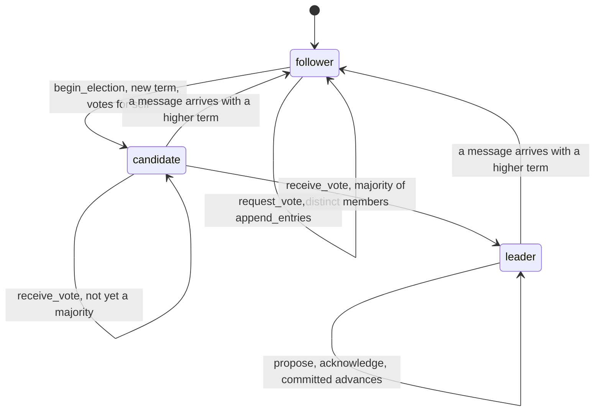
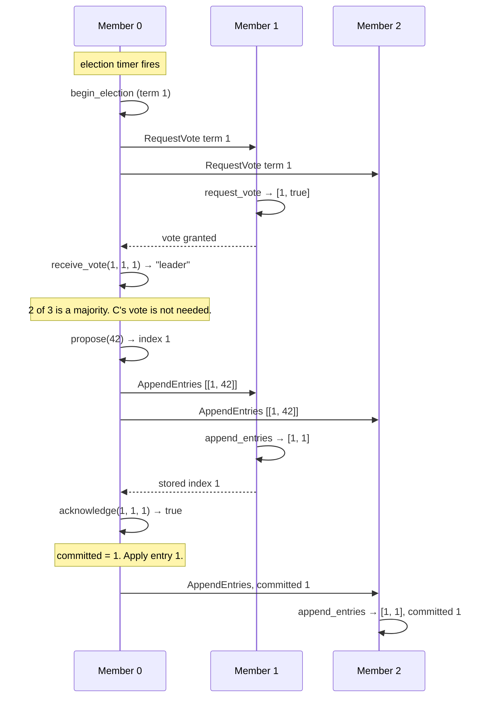

# ConsensusMachines

> Three nodes can all claim to be in charge. The log only believes the one with the votes. 🛸

A Raft rulebook for Ruby. Each node holds a `Raft` object that knows the current term, who it voted for, what's in its log, and how far that log is committed. You feed it the messages your nodes exchange. It tells you how to answer, when you've become leader, and which entries a majority has safely stored. The wires, the timers, and the disk are yours.

## Quick Start

```bash
gem 'consensus_machines'
```

```ruby
# Three members with ids 10, 20, 30. This process is member 0 (id 10).
node = ConsensusMachines::Raft.new([10, 20, 30], 0)

# Election timer fired. Start a term and vote for yourself.
node.begin_election        # => [0, 1, 0, 0]  send this RequestVote to the peers
node.receive_vote(1, 1, 1) # => "leader"      member 1 said yes: that's a majority of 3

# Leader work: append an entry, replicate it, count the acknowledgements.
node.propose(42)           # => 1             log index to replicate
node.acknowledge(1, 1, 1)  # => true          member 1 stored index 1 in term 1
node.committed             # => 1             a majority has it; apply it
```

Members are positional indices into the array you passed in. The second argument is which index you are.

## A Message to the Resistance

So you ran two database replicas with a `PRIMARY=true` flag and a health check that promotes the standby when the primary stops answering. Then a switch rebooted, the standby couldn't see the primary for nine seconds, promoted itself, and took writes. The primary, which was fine the whole time, also took writes. Nine seconds later you had two histories and no rule for picking one.

The fix is older than your cluster. A node leads only for a numbered term, only after a majority of distinct members voted for it in that term, and a write counts only once a majority has stored it. Two leaders in one term is impossible because nobody votes twice. A leader from an old term gets told the new term number and steps down.

That's Raft. The rules are precise and the bookkeeping is unforgiving, and that bookkeeping is this gem. Your code still sends the messages and writes the disk. The gem never lets you count a vote twice or commit a write the cluster didn't keep.

## Chapter 1: Stardate 2025.186, the AMS Ongaro

> **AMS Ongaro**, NCC-4204, *Ongaro*-class command vessel.
> Three bridges can speak. That does not make three orders authoritative.

The vessel doesn't broadcast. It keeps the ledger of command: which term it is, which bridge won it, which orders enough bridges have logged. An order from a bridge whose term has lapsed is logged nowhere.

Somewhere in the fleet, an ensign proposes:

```ruby
def primary?
  ENV['PRIMARY'] == 'true' || !ping(other_node)
end
```

"That," says the commander, "is how two bridges end up giving orders to the same engine."

## The Flight Plan

Every node is in one of three roles.



And the night the switch rebooted, on a three-member cluster:



## How Command Works

### Becoming a candidate

`begin_election` bumps the term, votes for yourself, and hands you the four numbers the peers need: your member index, the term, and your last log index and term.

```ruby
node = ConsensusMachines::Raft.new([10, 20, 30, 40, 50], 0)

node.begin_election   # => [0, 1, 0, 0]
node.role             # => "candidate"
node.term             # => 1
```

Send that as a RequestVote to every peer.

### Answering a vote request

A peer feeds the request into its own node and sends back what it gets. One vote per term, to the first eligible candidate who asked.

```ruby
peer = ConsensusMachines::Raft.new([10, 20, 30, 40, 50], 1)

peer.request_vote(0, 1, 0, 0)   # => [1, true]   member 0 gets the vote
peer.request_vote(2, 1, 0, 0)   # => [1, false]  member 2 asked too late
```

### Counting votes

`receive_vote` takes the peer's index, the term it voted in, and a ballot: 1 for yes, 0 for no. It returns your role afterwards. Repeats from the same member don't count twice.

```ruby
node.receive_vote(1, 1, 1)   # => "candidate"  1 of 5, plus yourself is 2
node.receive_vote(1, 1, 1)   # => "candidate"  same member, same vote
node.receive_vote(2, 1, 1)   # => "leader"     3 distinct of 5
```

### Proposing and committing

Only a leader can `propose`. It returns the log index to replicate. An entry is committed when a majority of distinct members has acknowledged that index in the current term.

```ruby
node.propose(99)              # => 1
node.committed                # => 0   nobody has it yet but you

node.acknowledge(1, 1, 1)     # => true
node.committed                # => 0   2 of 5 is not a majority
node.acknowledge(2, 1, 1)     # => true
node.committed                # => 1   3 of 5. Apply it.
node.entry(1)                 # => [1, 99]
```

The thing you propose is an Integer id. Keep the actual payload in your own store, keyed by that id.

### Replicating the log

Followers take `append_entries` with the leader's index, term, the index and term of the entry just before the new ones, the leader's commit index, and the entries as `[term, id]` pairs. The reply is the follower's term and the last index it now matches, or `nil` when the prefix didn't line up.

```ruby
follower = ConsensusMachines::Raft.new([10, 20, 30, 40, 50], 1)

follower.append_entries(0, 1, 0, 0, 0, [[1, 99]])   # => [1, 1]    stored index 1
follower.entry(1)                                   # => [1, 99]
follower.append_entries(0, 1, 1, 2, 0, [])          # => [1, nil]  prefix mismatch, refused
follower.append_entries(0, 1, 1, 1, 1, [])          # => [1, 1]    heartbeat carrying commit 1
follower.committed                                  # => 1
```

A `nil` match means the leader has to back up and send from an earlier index.

### Terms only go up

Any message carrying a higher term pulls the node into that term and back to follower. A leader from term 1 hearing about term 10 is a follower in term 10.

```ruby
node.role                     # => "leader"
node.receive_vote(1, 10, 0)
node.term                     # => 10
node.role                     # => "follower"
```

### Checkpoints

`checkpoint` captures the node as it is right now. `restore!` puts it back, as a follower. A checkpoint is good only for the node that made it and only until that node changes again.

```ruby
node = ConsensusMachines::Raft.new([10, 20, 30], 0)
node.begin_election
saved = node.checkpoint

node.restore!(saved)          # => true
node.role                     # => "follower"
node.term                     # => 1
```

Change the node and the old checkpoint is refused with `ArgumentError`. So is a checkpoint from a different node.

## The Rules of the Vessel

- **One to nine members**, all with distinct Integer ids. Your own index must be one of them. A majority is more than half of the real members, never padded.
- **Ids, terms, indices, and proposals are Integers** in `0..2**64-1`. Floats and strings raise `TypeError`. Negative or oversized raise `RangeError`.
- **Ballots are 0 or 1.** Anything else is `ArgumentError`.
- **The log holds 64 entries.** `propose` returns `nil` when it's full, and also when you're not the leader. Nothing is evicted.
- **A single-member cluster commits on propose.** It is its own majority.
- **Bad input changes nothing.** Every argument is checked before any state moves. A malformed entries array raises `TypeError` and the node is exactly as it was.
- **Frozen means frozen.** `freeze` the node and every mutation, including `restore!`, raises `FrozenError`. Reads still work.

## What You Think You're Doing vs Reality

### You Think: "The leader wrote it, so it's written."
### Reality: The leader wrote it to the leader.

Until a majority has acknowledged an index, that entry lives on one machine that could lose power before the next heartbeat. `committed` is the only number that means "safe to apply". Reading `last` and calling it durable is how you acknowledge a payment the cluster never kept.

## What's Yours

The node decides. You deliver. Every `request_vote` reply, every `append_entries` reply, and every acknowledgement you fold in must have been written to disk on the node that produced it before it was sent, or a crash can make the cluster forget a vote it already cast. Run the election timer, the heartbeat, and the retries yourself. Authenticate the messages. And apply entries to your state machine only up to `committed`, in order, exactly once.

## License

MIT License. See [LICENSE.txt](LICENSE.txt) for details.

**Remember: The standby was sure it was primary. So was the primary. The log was only sure about one of them.**
