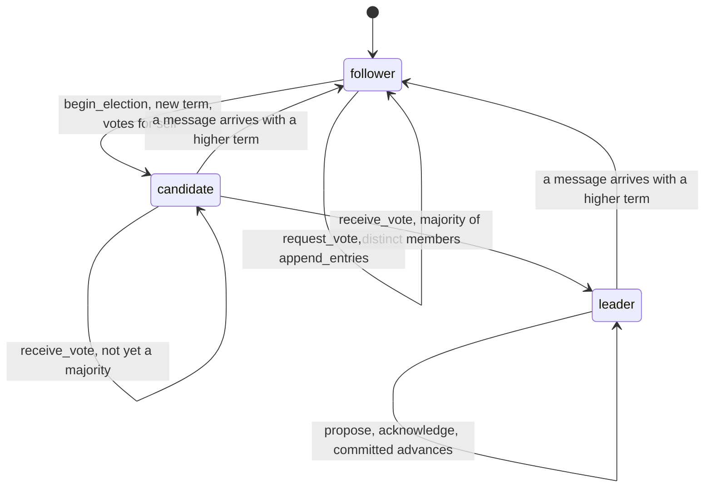
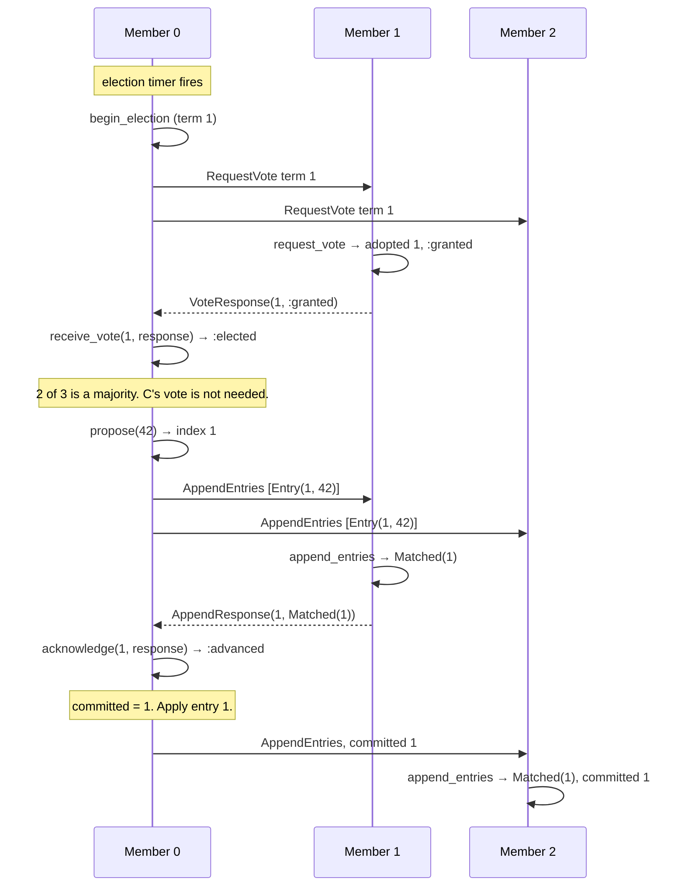

# ConsensusMachines

> Three nodes can all claim to be in charge. The log only believes the one with the votes. 🛸

A Raft rulebook for Ruby. Each node holds a `Raft` object that knows the current term, who it voted for, what's in its log, and how far that log is committed. You feed it the messages your nodes exchange. It tells you how to answer, when you've become leader, and which entries a majority has safely stored. The wires, the timers, and the disk are yours.

## Quick Start

```bash
gem 'consensus_machines'
```

```ruby
include ConsensusMachines

# Three members with ids 10, 20, 30. This process is member 0 (id 10).
node = Raft.new([10, 20, 30], 0)

# Election timer fired. Start a term and vote for yourself.
request = node.begin_election   # => VoteRequest(candidate: 0, term: 1, last: Position(0, 0))
# ...send it to the peers; member 1 answers VoteResponse(term: 1, vote: :granted)
node.receive_vote(1, VoteResponse.new(1, :granted))
# => Received(adopted: nil, role: :leader, outcome: :elected)   a majority of 3

# Leader work: append an entry, replicate it, fold in the replies.
node.propose(42)                # => 1   log index to replicate
node.acknowledge(1, AppendResponse.new(1, Matched.new(1)))
# => Received(adopted: nil, role: :leader, outcome: :advanced)
node.committed                  # => 1   a majority has it; apply it
```

Members are positional indices into the array you passed in. The second argument is which index you are.

## A Message to the Resistance

So you ran two database replicas with a `PRIMARY=true` flag and a health check that promotes the standby when the primary stops answering. Then a switch rebooted, the standby couldn't see the primary for nine seconds, promoted itself, and took writes. The primary, which was fine the whole time, also took writes. Nine seconds later you had two histories and no rule for picking one.

The fix is older than your cluster. A node leads only for a numbered term, only after a majority of distinct members voted for it in that term, and a write counts only once a majority has stored it. Two leaders in one term is impossible because nobody votes twice. A leader from an old term gets told the new term number and steps down.

That's Raft. The rules are precise and the bookkeeping is unforgiving, and that bookkeeping is this gem. Your code still sends the messages and writes the disk. The gem never lets you count a vote twice or commit a write the cluster didn't keep.

## Chapter 1: Stardate 2025.186, the AMS Ongaro

> **AMS Ongaro**, NCC-4204, *Ongaro*-class command vessel.
> Three bridges can speak. That does not make three orders authoritative.

The vessel doesn't broadcast. It keeps the ledger of command: which term it is, which bridge won it, which orders enough bridges have logged. An order from a bridge whose term has lapsed is logged nowhere.

Somewhere in the fleet, an ensign proposes:

```ruby
def primary?
  ENV['PRIMARY'] == 'true' || !ping(other_node)
end
```

"That," says the commander, "is how two bridges end up giving orders to the same engine."

## The Flight Plan

Every node is in one of three roles.



And the night the switch rebooted, on a three-member cluster:



## How Command Works

### Two stages, one answer

Every message a node receives is handled in two stages, and the answer shows both. It comes back as `Received(adopted, role, outcome)`.

First the terms are reconciled. If the sender is in a higher term, the node moves into it, forgets its vote, and becomes a follower: `adopted` is that term. Otherwise `adopted` is `nil`. Then the message itself is answered: that is `outcome`. The two are independent. A node can adopt a term and still deny the vote that carried it, and you have to write that new term to disk either way.

A denied vote or a rejected append is not a failure. It is the reply Raft wants you to send back. A *refusal* is different: the call made no sense on this node (a member index that doesn't exist, a proposal on a follower), nothing changed, not even the term, and you get a bare Symbol. See [Every answer](#every-answer).

### Becoming a candidate

`begin_election` bumps the term, votes for yourself, and hands you the `VoteRequest` the peers need: your member index, the term, and your last log position.

```ruby
node = Raft.new([10, 20, 30, 40, 50], 0)

node.begin_election   # => VoteRequest(candidate: 0, term: 1, last: Position(index: 0, term: 0))
node.role             # => :candidate
node.term             # => 1
```

Send that as a RequestVote to every peer.

### Answering a vote request

A peer feeds the request into its own node and sends back the `outcome`. One vote per term, to the first eligible candidate who asked.

```ruby
peer = Raft.new([10, 20, 30, 40, 50], 1)
ask  = VoteRequest.new(0, 1, Position.new(0, 0))

peer.request_vote(ask)
# => Received(adopted: 1, role: :follower, outcome: VoteResponse(term: 1, vote: :granted))
peer.request_vote(ask).outcome.vote                                    # => :duplicate   asked again, same answer
peer.request_vote(VoteRequest.new(2, 1, Position.new(0, 0))).outcome.vote
# => Denied(reason: :already_voted)                                    member 2 asked too late
```

`:duplicate` is a yes: this candidate already has the vote, and nothing changed. The reasons for a no are `:term_behind`, `:already_voted` and `:log_behind`.

### Counting votes

`receive_vote` takes the peer's index and its `VoteResponse`. The outcome says what the ballot did. Repeats from the same member don't count twice.

```ruby
yes = VoteResponse.new(1, :granted)

node.receive_vote(1, yes).outcome   # => :counted     1 of 5, plus yourself is 2
node.receive_vote(1, yes).outcome   # => :duplicate   same member, same vote
node.receive_vote(2, yes).outcome   # => :elected     3 distinct of 5
node.role                           # => :leader
```

A no is `:denied`. A vote that arrives after you won is still `:counted`; nobody is elected twice.

### Proposing and committing

Only a leader can `propose`. It returns the log index to replicate. An entry is committed when a majority of distinct members has acknowledged that index in the current term.

```ruby
node.propose(99)                                    # => 1
node.committed                                      # => 0   nobody has it yet but you

stored = AppendResponse.new(1, Matched.new(1))      # what a follower answered
node.acknowledge(1, stored).outcome                 # => :advanced
node.committed                                      # => 0   2 of 5 is not a majority
node.acknowledge(1, stored).outcome                 # => :duplicate
node.acknowledge(2, stored).outcome                 # => :advanced
node.committed                                      # => 1   3 of 5. Apply it.
node.entry(1)                                       # => Entry(term: 1, command: 99)
```

The thing you propose is an Integer id. Keep the actual payload in your own store, keyed by that id.

### Replicating the log

Followers take `append_entries` with an `AppendRequest` (the leader's index, its term, the position just before the new entries, the leader's commit index) and the entries. The reply says how far the follower's log now agrees with the leader's.

```ruby
follower = Raft.new([10, 20, 30, 40, 50], 1)
start    = Position.new(0, 0)

follower.append_entries(AppendRequest.new(0, 1, start, 0), [Entry.new(1, 99)])
# => Received(adopted: 1, role: :follower, outcome: AppendResponse(term: 1, append: Matched(index: 1)))
follower.entry(1)                                                             # => Entry(term: 1, command: 99)
follower.append_entries(AppendRequest.new(0, 1, Position.new(2, 1), 0), []).outcome.append
# => :conflict                                                                nothing at index 2 yet
follower.append_entries(AppendRequest.new(0, 1, Position.new(1, 1), 1), []).outcome.append
# => Matched(index: 1)                                                        heartbeat carrying commit 1
follower.committed                                                            # => 1
```

Hand each reply to the leader's `acknowledge`. `:conflict` means the leader has to back up and send from an earlier position. `:term_behind` means the leader is from an old term, and the reply carries the term it should adopt.

### Terms only go up

Any message carrying a higher term pulls the node into that term and back to follower, and the answer says so in `adopted`. A leader from term 1 hearing about term 10 is a follower in term 10.

```ruby
node.role                     # => :leader
node.receive_vote(1, VoteResponse.new(10, Denied.new(:term_behind)))
# => Received(adopted: 10, role: :follower, outcome: :overtaken)
node.term                     # => 10
```

Only an honoured message does this. A refused one adopts nothing.

### Checkpoints

`checkpoint` is the node's durable state as plain data: members, seat, term, vote, commit index, entries. Write it to disk however you like. `Raft.restored` builds the node back from it, as a follower.

```ruby
node = Raft.new([10, 20, 30], 0)
node.begin_election
saved = node.checkpoint
# => Checkpoint(members: [10, 20, 30], own: 0, term: 1, voted_for: 0, committed: 0, entries: [])

node = Raft.restored([10, 20, 30], 0, saved)
node.role                     # => :follower
node.term                     # => 1
```

You say which membership and which seat you are restoring. A checkpoint from a different membership or seat raises `RangeError`. One no node could ever be in (a vote for a member that doesn't exist, entries from a term the node never reached) never gets that far: `Checkpoint.new` itself raises `RangeError`, because a `Checkpoint` that exists is a state a node can be in. What the gem cannot know is whether the checkpoint is the *latest* one. That is your disk's job: restore an old one and the node can forget a vote it already cast.

### Every answer

A call that is honoured answers with a value. A call that is not honoured answers with one of the refusal symbols below, and only those, and changes nothing: no term adopted, no vote, no role change, no entry. Each refusal is the snake_case of one core `Refusal` variant; there is no catch-all symbol and refusals never raise. A `:duplicate` is an honoured repeat: what the call asked for already holds, and nothing changed.

| Call | Honoured | Refusals | Records the clock |
| --- | --- | --- | --- |
| `begin_election` | `VoteRequest` | `:term_exhausted` | no |
| `request_vote(request)` | `Received` of a `VoteResponse` whose `vote` is `:granted`, `:duplicate` (this candidate already has the vote), `Denied(:term_behind)`, `Denied(:already_voted)` or `Denied(:log_behind)` | `:unknown_member`, `:own_seat` | no |
| `receive_vote(peer, response)` | `Received` of `:counted`, `:elected`, `:duplicate` (member already counted), `:denied` or `:overtaken` (term adopted) | `:unknown_member`, `:own_seat`, `:stale`, `:not_candidate` | no |
| `propose(command)` | the new index | `:not_leader`, `:log_full` | no |
| `append_entries(request, entries)` | `Received` of an `AppendResponse` whose `append` is `Matched(index)` (also for entries already held), `:conflict` or `:term_behind` | `:unknown_member`, `:own_seat`, `:malformed` (entry terms going backwards or above the request's), `:too_many_entries`, `:rival_leader`, `:mismatch`, `:committed_conflict` | no |
| `acknowledge(peer, response)` | `Received` of `:advanced`, `:duplicate` (at or below the recorded match), `:conflict` or `:overtaken` (term adopted) | `:unknown_member`, `:own_seat`, `:stale`, `:not_leader`, `:beyond_log` | no |

There is no clock in this vessel: no call takes, reads or records one, so no answer depends on an instant.

`Denied(...)`, `:conflict`, `:term_behind`, a ballot `:denied` and an ack `:conflict` say "no", and they are still honoured answers: they are protocol replies Raft sends back to the asker, and a refusal sends nothing back.

The core answers `:malformed` to a vote request, a vote reply or an append reply that contradicts itself (a zero term, a position that cannot exist, a "term behind" from term one). None of those values can be built in Ruby (see below), and one forged past `initialize` (a leaked subclass, `Marshal.load`) raises `TypeError` or `RangeError` before the node is asked, so `request_vote`, `receive_vote` and `acknowledge` never answer it here; in the core, such a reply is refused before its term is looked at, so it never moves a node into the term it carries.

What the refusals mean:

- `:unknown_member`, `:own_seat`: the index is not another member's seat.
- `:malformed`: the entries contradict the request: an entry term above the request's, or entry terms going backwards. (A zero term or an impossible position can't reach the node: those values raise when you build them.)
- `:too_many_entries`: the entries end past index `Raft::CAPACITY` (64).
- `:stale`: a response from a term the node has left, or one answering a request it sent back then.
- `:not_candidate`, `:not_leader`: a response for the current term, but the node isn't in the role that asked.
- `:rival_leader`: an append from someone else in the term this node leads. One term, one leader; the node keeps its log.
- `:mismatch`: an entry differs from the one the log holds at the same index and term.
- `:committed_conflict`: the entries would replace one the node has committed.
- `:beyond_log`: a reply claims a match past the end of the leader's log.
- `:log_full`, `:term_exhausted`: no room for another entry, no term after `2**64-1`.

`:mismatch` and `:committed_conflict` are not part of the conversation between honest nodes. They are refused even when the append carries a higher term: the node adopts no term, changes nothing and has no reply to send. Either this node's log or the sender's is corrupt (lost storage, an old checkpoint restored, two clusters wired together). Don't reply, don't retry around it: stop the node and tell an operator.

`Raft.new`, `Raft.restored`, `members`, `own`, `role`, `term`, `committed`, `last`, `entry` and `checkpoint` never refuse. The two constructors raise `RangeError` for a configuration that can't exist or a checkpoint of another membership or seat.

## The Rules of the Vessel

- **One to nine members** (`Raft::MEMBERS`, the core's `Raft::MEMBERS` sizes the gem is compiled for), all with distinct Integer ids. Your own index must be one of them. A majority is more than half of the real members, never padded.
- **Ids, terms, indices, and proposals are Integers** in `0..2**64-1`. Floats and strings raise `TypeError`. Negative or oversized raise `RangeError`.
- **Terms and indices are protocol numbers, not handles.** Every member has to agree on what term 7 and index 3 mean, on every node and after every restart, so they are bare Integers with no scope, they mean the same thing cluster-wide on purpose, and they live in the checkpoint. An index is handed out again when an uncommitted tail is replaced; only index and term together name an entry.
- **Values mirror the core.** `Position`, `Entry`, `VoteRequest`, `VoteResponse`, `AppendRequest`, `AppendResponse`, `Received` and `Checkpoint` are `Data` with the core struct's fields in the core's order, passed positionally. An enum variant with a field is a `Data` named after it (`Denied`, `Matched`); one without is a Symbol (`:granted`, `:conflict`, every role). Passing anything else raises `TypeError`; an unknown symbol raises `RangeError`.
- **A value is valid or does not exist.** Every `Data` goes through the core's validating constructor, on `new` and on `with`, whoever builds it: `Position.new(1, 0)`, `Entry.new(0, 7)`, `VoteRequest.new(0, 0, EMPTY)`, `VoteResponse.new(1, Denied.new(:term_behind))`, `Received.new(nil, :follower, :elected)` and a `Checkpoint` no node can be in (a vote in term zero included) all raise `RangeError`; a wrong type raises `TypeError`. `ArgumentError` is Ruby's own, for the wrong number of arguments. `Checkpoint` stores frozen copies of its two Arrays.
- **The binding never loses work.** Every check that can raise runs before the node is asked. Building the answer runs Ruby (`Received.new`, `VoteRequest.new` and the rest), so the node decides on a copy, the answer is built, and the copy is kept only if the node is still unfrozen (`FrozenError` otherwise) and unchanged (`RuntimeError` otherwise: something re-entered it while the answer was built). A call that raised changed nothing. `propose` answers an Integer or a Symbol and decides in place.
- **The binding is the authority on values.** Every `Data` class is sealed (no `allocate`, no subclass), but Ruby binds a subclass constant before `inherited` raises, `Data#initialize` can be bound directly and `Marshal.load` skips `initialize`. So the native side reads a message, an entry or a checkpoint only when it is exactly this gem's class (a subclass raises `TypeError`, whatever it holds) and checks every field again through the core's constructor (`RangeError`): a forged value never reaches the node and never earns `:malformed`.
- **A refusal is a Symbol, never an exception, and changes nothing.** A higher term in a refused message is not adopted.
- **The log holds 64 entries** (`Raft::CAPACITY`, the core's `Raft::CAPACITY`). `propose` answers `:log_full` when it's full. Nothing is evicted.
- **A single-member cluster leads on `begin_election` and commits on `propose`.** It is its own majority.
- **Bad input changes nothing.** Every argument is checked before any state moves. A malformed entries array raises `TypeError` and the node is exactly as it was. Entries are never coerced: no `to_ary`, no duck typing.
- **No clock.** Terms and indices are logical. Election timeouts and heartbeats are yours.
- **Frozen means frozen.** `freeze` the node and every mutation raises `FrozenError`. Reads, `checkpoint` included, still work.

## What You Think You're Doing vs Reality

### You Think: "The leader wrote it, so it's written."
### Reality: The leader wrote it to the leader.

Until a majority has acknowledged an index, that entry lives on one machine that could lose power before the next heartbeat. `committed` is the only number that means "safe to apply". Reading `last` and calling it durable is how you acknowledge a payment the cluster never kept.

## What's Yours

The node decides. You deliver. Every `request_vote` reply, every `append_entries` reply, and every acknowledgement you fold in must have been written to disk on the node that produced it before it was sent, or a crash can make the cluster forget a vote it already cast. That means: after every honoured call, `checkpoint`, write it, then send. An answer with `adopted` set changed the term even if its outcome is a no. Run the election timer, the heartbeat, and the retries yourself. Authenticate the messages. And apply entries to your state machine only up to `committed`, in order, exactly once.

## License

MIT License. See [LICENSE.txt](LICENSE.txt) for details.

**Remember: The standby was sure it was primary. So was the primary. The log was only sure about one of them.**
